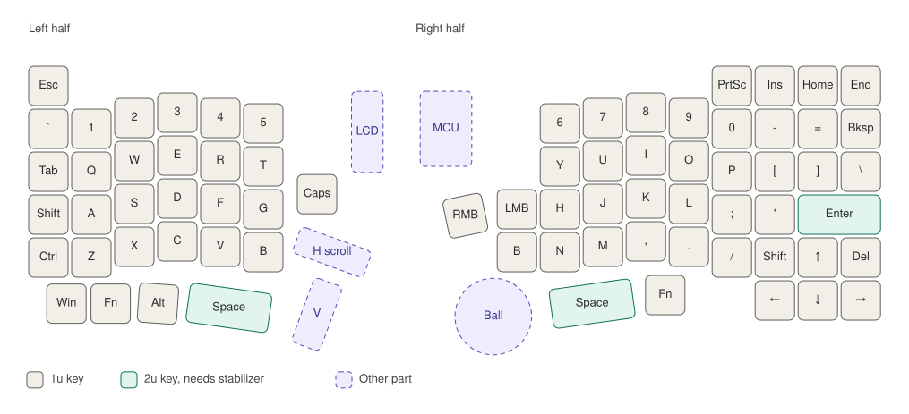

# Pinvyn keyboard

This is my first keyboard, inspired by many, my wrist pain also calling for it.

Pinvyn is a split keyboard for coding and writing, with a thumb trackball on the right half and two scroll wheels on the left. The layout stays close to a standard keyboard so there is little to relearn.

**Status (2026-11-15):** the layout for the first prototype (v0.1) is agreed. Next come parts, a printed case and hand-wiring.

## v0.1 in short

- 73 keys: 30 on the left half, 43 on the right, full-height MX switches, column stagger.
- A 2u Space on each half and a 2u Enter.
- 34 mm trackball under the right thumb, mouse buttons next to the H column.
- Two scroll wheels on the left half, one for up/down and one for left/right.
- Hold-Fn layer key on each half; the number row becomes F1 to F12.
- A cable between the halves; USB or Bluetooth to the computer; one battery in the left half.
- One small low-power display on the left half for battery status.
- ZMK firmware.
- Hand-wired on a printed plate first. A PCB follows once the prototype has been used for real.

## Repository

| Path | What it holds |
|---|---|
| [docs/HANDOFF.md](docs/HANDOFF.md) | Build guide and handoff: start here to continue the project |
| [docs/design.md](docs/design.md) | Design decisions, the reasons behind them and the open questions |
| [docs/wiring.md](docs/wiring.md) | Wiring plan for v0.1: key matrix, controller pins, diagrams |
| [docs/bom.md](docs/bom.md) | Parts list for v0.1 and where to order |
| [layout/pinvyn-v0.1-layout.json](layout/pinvyn-v0.1-layout.json) | Key and part positions per half |
| [layout/pinvyn-v0.1-layout.svg](layout/pinvyn-v0.1-layout.svg) | Layout drawing |
| [case/generate_plate.py](case/generate_plate.py) | Script that produces the printable switch plates and a fit-test piece (STL files in `case/`) |
| [layout/generate_layout.py](layout/generate_layout.py) | Script that produces both layout files |

## Next steps

1. Order the parts in [docs/bom.md](docs/bom.md).
2. Model the switch plate and case for the resin printer.
3. Print, hand-wire and flash ZMK.
4. Use it, adjust key angles and the trackball position, then design the PCB.

## License

**Hardware** (PCB files, case STLs, Ergogen config, schematics)
© 2026 ExiledRain — [CC BY-NC-SA 4.0](LICENSE-HARDWARE)
Commercial use requires explicit written permission from the author.

**Firmware** (ZMK config, keymaps)
© 2026 ExiledRain — [MIT](LICENSE-FIRMWARE)
