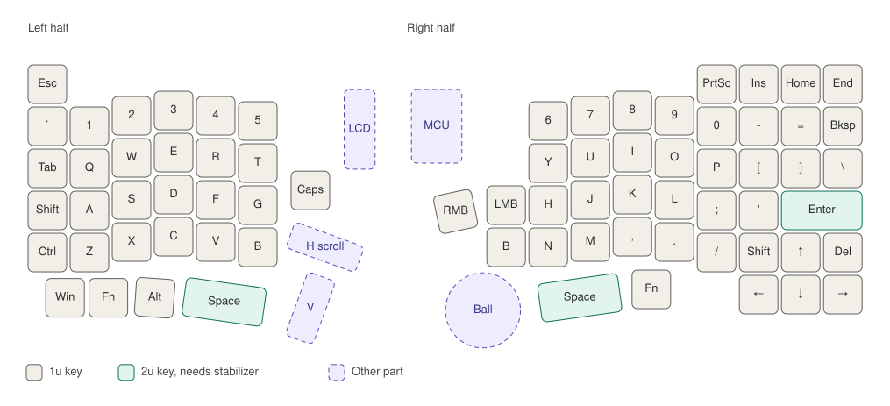

# Pinvyn v0.1 build guide and handoff

Written 2026-11-15. This file is the single starting point for anyone, human or AI model, who continues the project. Read it first, then `docs/design.md`, `docs/bom.md` and `layout/pinvyn-v0.1-layout.json`.

## 1. How to continue from here

- **Principle:** build the first version, see what is wrong, then fix only that. Do not optimise parts that do not exist yet.
- **Owner:** ExiledRain. Experienced Java developer, new to keyboard electronics, soldered daily about ten years ago and will manage with some guidance. Owns a resin printer (Elegoo Saturn 4 Ultra 16K). Orders from the EU (Estonia).
- **Working style:** short answers. When a point is unclear, lay out the options and ask one question. No long explanations unless asked.
- **Marked items:** anything tagged **VERIFY** below was not confirmed against a datasheet or current documentation. Check it before acting on it.
- **After each work session:** update this file's status section and the open list, and commit.

## 2. Status

| Area | State |
|---|---|
| Layout | Agreed as the base prototype. Angles are a first guess from a paper sketch |
| Parts | Chosen, see section 5. Ball ordered or about to be; the rest still to order |
| Case | First step done: `case/generate_plate.py` produces a switch plate with a skirt for each half and a small fit-test piece. Not printed yet. Trackball cup, scroller mounts, tray and openings still to do |
| Wiring plan | Done as a plan in `docs/wiring.md`: matrix, pins and diagrams. Not built or tested |
| Firmware | Not started |
| PCB | Deliberately postponed until v0.1 has been used |

## 3. What Pinvyn is

A split keyboard for coding and writing. It keeps most keys where a regular keyboard has them, and adds a thumb trackball and two scroll wheels so the hands stay on the board. Later it should carry a holder for an unfolded phone and lift-up legs along the inner edges.

Name: **Pinvyn**. Brand: ExiledRain. Product mark: a red feather. Licences: hardware CC BY-NC-SA 4.0, firmware MIT.

## 4. Decisions that are locked for v0.1

### Layout

- 73 keys, 30 left and 43 right. Full-height MX switches, 19.05 mm spacing, column stagger.
- Exact positions, sizes and rotations: `layout/pinvyn-v0.1-layout.json`. Regenerate with `python3 layout/generate_layout.py`, then `python3 layout/generate_wiring.py`, in that order.
- Three 2u keys: Space on each half and Enter.
- Size before case walls: left about 158 × 128 mm, right about 205 × 129 mm.

Base layer, left half:

| Row | Keys |
|---|---|
| Top | Esc |
| Numbers | `` ` `` 1 2 3 4 5 |
| Upper | Tab Q W E R T |
| Home | Shift A S D F G |
| Lower | Ctrl Z X C V B |
| Thumb | Win, Fn, Alt, Space (2u) |
| Apart | Caps Lock, above the horizontal scroller |

Base layer, right half:

| Row | Keys |
|---|---|
| Top | PrtSc Ins Home End (above 0 - = Bksp) |
| Numbers | 6 7 8 9 0 - = Bksp |
| Upper | Y U I O P [ ] \ |
| Home | H J K L ; ' Enter (2u) |
| Lower | N M , . / Shift ↑ Del |
| Bottom | ← ↓ → (under Shift ↑ Del) |
| Thumb | Space (2u), Fn |
| Inner | Right click, left click (left of H), second B (left of N) |

Fn layer. Fn is a hold key, active only while pressed, on both thumb rows:

| Hold Fn + | Gives |
|---|---|
| 1 … 0, -, = | F1 … F12 |
| I / J / K / L | ↑ / ← / ↓ / → |
| U / O | PgUp / PgDn |
| M | Menu |

### Pointing

- 34 mm trackball under the right thumb. Sensor: PMW3610, chosen for low power and ZMK support. The PMW3360 is more accurate but power-hungry and needs a different board and mount.
- The ball rests on three static 2.5 mm ceramic balls (ZrO2 or Si3N4). They do not rotate.
- Mouse buttons sit above the ball and are pressed with the index finger, so dragging works.
- Two scrollers on the left half. The one near the thumb scrolls up/down, the upper one left/right. Each is a mouse-wheel encoder with a printed wheel.

### Connection, power, display

- TRRS cable between the halves, using ZMK's wired split. ZMK calls this transport new and for early adopters.
- USB or Bluetooth from the left half to the computer or phone.
- One battery, in the left half. Leave room for a second in the right half.
- No dongle: ZMK cannot mix a wired link between the halves with a dongle.
- One low-power display (nice!view type) on the left half for battery status. None on the right.

### Build approach

- v0.1 is hand-wired with loose diodes on a printed switch plate in a printed tray case. No PCB.
- Firmware: ZMK. Controllers build as `nice_nano_v2`.

## 5. Parts

| Part | Qty | Notes |
|---|---|---|
| SuperMini nRF52840 (nice!nano v2 clone) | 2 + 1 spare | One per half |
| nice!view-type display, 36 × 14 mm | 1 | Left half |
| Perixx PERIPRO-303 trackball, 34 mm | 1 | Seen at €11.99 on perixx.com |
| PMW3610 sensor board with LM18-LSI lens | 1 | Prefer a badjeff or siderakb design, because the reference mount is drawn for those. Buy the complete module, not the bare chip |
| Ceramic balls, 2.5 mm | 3, buy a bag | Ball supports |
| Mouse-wheel encoders | 2 + 2 spare | Scrollers. Not the discontinued EVQWGD001 |
| MX switches | 73, buy 80 | |
| Keycaps incl. three 2u | 1 set | |
| 2u stabilizers, **plate-mount** | 3 | There is no PCB in v0.1, so PCB-mount stabilizers have nothing to sit in |
| 1N4148 diodes, through-hole DO-35 | 80 | One per switch |
| TRRS jacks, 4-pole | 2 | |
| TRRS cable, 4-pole | 1 | |
| LiPo battery 3.7 V | 1 | Size to be fixed with the case |
| Slide power switch | 1 | |
| Soldering iron, solder, flux, side cutters, tweezers, multimeter | | To buy or borrow |
| Solid wire for rows and columns, thin stranded wire for the rest | | |
| M2 or M3 screws and heat-set inserts | | Case and sensor board |

Shop links were collected separately by the owner. Add them to `docs/bom.md`.

## 6. Reference designs

| Design | Use | Limits |
|---|---|---|
| A small ZMK trackball module found by the owner (link to be added here) | Cup dimensions: 34 mm mount, PMW3610, 2.5 mm static ceramic balls | Licence not checked yet. **VERIFY** before copying geometry |
| Bastardkb/34-mm-trackball-holder | General idea of a two-part holder, has a STEP file | Built for a PMW3360 board and MR63 roller bearings |
| Bastardkb/Charybdis | Proven 34 mm trackball keyboard | CC BY-NC-SA 4.0, non-commercial |
| Keychron Orca Echo files | Idea of lift-up legs only | Source-available, 19 mm ball, no commercial copying |

Because Pinvyn may be sold one day, draw Pinvyn's own cup and case. Use the references for measurements and ideas, not for geometry.

## 7. Path to v0.1

### Step 1: order

Order everything in section 5. AliExpress orders first, they take longest.

### Step 2: measure what arrives

Record in `docs/measurements.md`: sensor board outline and hole spacing, encoder body and shaft, display, controller, TRRS jack, power switch, battery. The case is drawn from these numbers, not from listings.

### Step 3: model the case

Start from `case/generate_plate.py` (Python with shapely and trimesh), which already reads `layout/pinvyn-v0.1-layout.json` and writes STL files. Print `case/pinvyn-v0.1-coupon.stl` first. The layout is already data, and a script can be regenerated when angles change.

Per half: a switch plate and a tray that screws to it.

- Switch cutout 14.0 × 14.0 mm. Plate 1.5 mm thick where the switch clips in.
- Stabilizer cutouts for the three 2u keys: take the standard Cherry plate-mount cutout from a plate generator. **VERIFY** against the stabilizers bought.
- Trackball cup: bowl for a 34 mm ball with about 0.5 mm clearance, three pockets for 2.5 mm balls, a window and seat for the sensor board. The lens must sit at the distance the sensor's datasheet asks for. **VERIFY** in the PMW3610 datasheet; 2.4 mm from lens to ball was mentioned by one source.
- Scroller mounts for the measured encoders, turned 20°.
- Openings: USB on the left controller, TRRS jack on each half, power switch, display window on the left.
- Space for the controller under the display (left) and in the inner top corner (right), and for the battery.
- Threaded inserts along the inner edges for the future legs.
- The right half is likely larger than the print bed. Split it or print it tilted.

Print small test pieces before a whole half: a 2 × 2 switch coupon with one stabilizer, and the cup alone. Resin holes tend to come out tight, so try 14.0, 14.1 and 14.2 mm. Use a tough or ABS-like resin; standard resin is brittle where switches clip in.

### Step 4: wire

- One diode per switch, all facing the same way. Diode legs form the rows, separate wires form the columns.
- Follow `docs/wiring.md` for the matrix, the pins and the order of work.
- Always switch the power off before plugging or unplugging the TRRS cable. The plug shorts contacts as it slides in.

### Step 5: firmware

A ZMK config repository with a left (central) and right (peripheral) shield:

- Matrix transform matching the wiring.
- Wired split over UART. **VERIFY** the current setup in the ZMK split documentation.
- PMW3610 on the right half. ZMK moved to a newer Zephyr in December 2025, which ships its own PMW3610 driver; the badjeff driver is said to remain usable under the name `pmw3610-alt`. **VERIFY** which one to use.
- Two encoders mapped to vertical and horizontal scroll.
- nice!view display, battery reporting, Bluetooth and USB output.
- Keymap from section 4.

### Step 6: use it and write down what is wrong

Keep `docs/issues.md`. Typical things to judge: thumb reach to the ball, key angles, Caps Lock position, scroller feel, cursor jitter, battery life. That list decides what v0.2 and the PCB change.

## 8. Pin budget

The full pin assignment is in `docs/wiring.md`. Summary:

A nice!nano v2-type board has 18 pins on its edges and 3 more pads underneath, 21 in total. **VERIFY** on the boards bought.

| Half | Needs | Pins |
|---|---|---|
| Left | 30 keys as a 5 × 6 matrix | 11 |
| | 2 encoders | 4 |
| | Display | 3 |
| | Link to right half (TX, RX) | 2 |
| | **Total** | **20 of 21** |
| Right | 43 keys as a 6 × 8 matrix | 14 |
| | Trackball sensor (clock, data, select, motion) | 4 |
| | Link to left half (TX, RX) | 2 |
| | **Total** | **20 of 21** |

Both halves are nearly full. Plan the pins before soldering, and do not add LEDs or extra parts without freeing a pin first.

TRRS carries four lines: power, ground, TX, RX. How the right half takes power from the cable is not decided. **VERIFY** before wiring.

## 9. Open list

- Link and licence of the reference trackball module.
- Sensor board model actually bought.
- Battery size.
- Keycap profile.
- Where exactly the controllers, jacks, USB port and switch sit.
- Power feed to the right half over TRRS.
- RGB lighting and macro keys from the earliest notes were never discussed for this design.
- `LICENSE-HARDWARE` is a summary. Replace it with the full CC BY-NC-SA 4.0 legal text.

## 10. Sources

- ZMK split keyboards: <https://zmk.dev/docs/features/split-keyboards>
- ZMK dongle: <https://zmk.dev/docs/hardware-integration/dongle>
- PMW3610 driver for ZMK: <https://github.com/badjeff/zmk-pmw3610-driver>
- ZMK update and the PMW3610 driver: <https://note.com/nykx/n/n7d26002e812a?hl=en>
- siderakb PMW3610 board: <https://github.com/siderakb/pmw3610-pcb>
- Trackball bearing comparison: <https://kbd.news/Trackball-bearing-comparison-1757.html>
- Bastard Keyboards 34 mm holder: <https://github.com/Bastardkb/34-mm-trackball-holder>
- Charybdis: <https://github.com/Bastardkb/Charybdis>
- Parts list of a comparable build: <https://docs.bastardkb.com/help/bluetooth.html>
- SuperMini nRF52840: <https://github.com/joric/nrfmicro/wiki/ALternatives>
- nice!view: <https://kbd.news/nice-view-1674.html>
- Mouse-encoder replacement for the roller encoder: <https://ergomech.store/blog/ergomech-blog-1/the-roller-encoder-is-dead-long-live-the-roller-encoder-13>
- Keychron Orca Echo design files: <https://github.com/Keychron/Keychron-Keyboards-Hardware-Design/blob/main/Special-Series/Orca/README.md>
