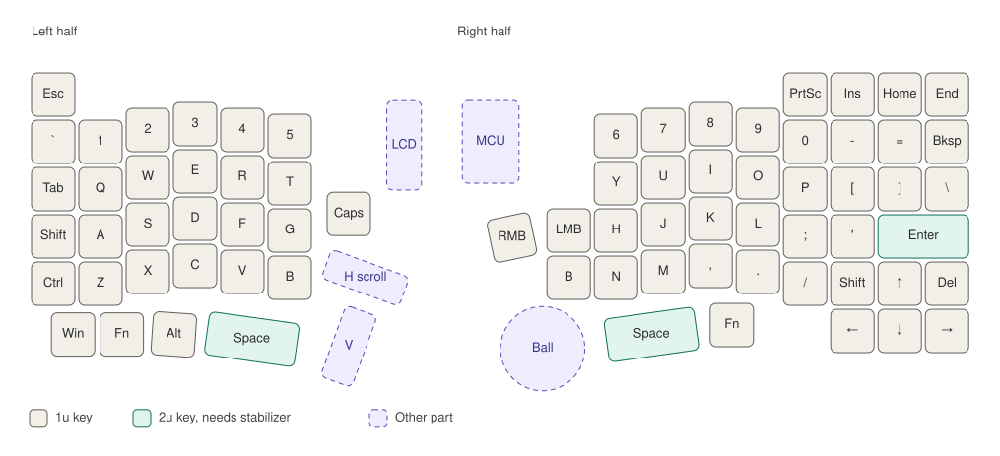

# Pinvyn v0.1 design

State on 2026-11-15. This file records what was decided, why, and what is still open. Positions live in [`layout/pinvyn-v0.1-layout.json`](../layout/pinvyn-v0.1-layout.json).

## Goal

A split keyboard for coding and writing that keeps most keys where a regular keyboard has them, adds a trackball and scroll wheels so the hands stay on the board, and can later carry a holder for an unfolded phone.

v0.1 is a prototype to judge the feel in real life: key angles, thumb reach and the trackball position. It is not the final hardware.

## Layout

- **73 keys**: 30 left, 43 right. Full-height MX switches, 19.05 mm spacing.
- **Column stagger** (downward offset in key units, outer to inner): left `0.375, 0.375, 0.125, 0, 0.125, 0.25`; the right half mirrors it and its four outer columns all sit at `0.375`.
- **Left half**: Esc above a `` ` `` key, number row 1 to 5, then Tab, Shift and Ctrl in the outer column. Thumb row: Win, Fn, Alt, 2u Space.
- **Right half**: number row 6 to Backspace, with PrtSc, Ins, Home and End above the last four keys. 2u Enter, right Shift, Del, and an inverted-T arrow cluster in the bottom-right corner. Thumb row: 2u Space, Fn.
- **Two Space keys**, one per half, because Space gets pressed with both thumbs.
- **Second B** on the right half, left of N, for people who reach B with the right hand.
- **Caps Lock** is a normal key, set apart above the horizontal scroller so it is not hit by accident.
- **Angles**, taken from the paper sketch: both Space keys 8°, left Alt 4°, right mouse button 12°, both scrollers 20°.
- **Size before case walls**: left about 158 × 128 mm, right about 205 × 129 mm. The right half is wider because the right side of a standard layout holds more keys.

Left out on purpose: PgUp, PgDn and Menu as physical keys, and a slide switch for Caps Lock.

### Fn layer

Fn is a hold key, like Fn on a laptop: active only while held, no toggle and no status light. There is one on each thumb row so either hand can hold it.

| Hold Fn + | Gives | Status |
|---|---|---|
| 1 … 0, -, = | F1 … F12 | Agreed |
| I / J / K / L | ↑ / ← / ↓ / → | Proposed |
| U / O | PgUp / PgDn | Proposed |
| a spare key | Menu | Proposed |

## Pointing

- **Trackball**: 34 mm ball under the right thumb, PMW3610 sensor underneath. The thumb keeps the fingers on the keys while the cursor moves.
- **Mouse buttons** sit above the ball, left of the H column, and are pressed with the index finger. Dragging needs a different finger on the button than on the ball, which rules out buttons below the ball.
- **Scrollers** on the left half: the one near the thumb scrolls up/down, the upper one left/right. Each is a mouse-wheel encoder with a printed wheel. The Panasonic EVQWGD001 roller encoder was the first pick but is discontinued and expensive.

## Connection and power

- **Between the halves**: a 4-pole TRRS cable, using ZMK's wired split. It carries power to the right half, so only the left half needs a battery. ZMK labels the wired link as new and meant for early adopters.
- **To the computer or phone**: USB cable or Bluetooth, both from the left half.
- **Battery**: one, in the left half. The case leaves room for a second one in the right half.
- **No dongle in v0.1.** ZMK links the halves either over Bluetooth or over a wire and cannot mix the two. A dongle makes both halves wireless, so it cannot be combined with the cable. With a second battery and new firmware the dongle setup stays possible later.
- **Display**: one small memory-LCD (nice!view type) on the left half for battery status. No display on the right half.
- Left out to save battery: OLED displays.

## Firmware

ZMK. The controllers are nRF52840 boards of the nice!nano v2 type and build as `nice_nano_v2`. The PMW3610 needs a community driver module.

## How v0.1 gets built

1. Print a switch plate and a simple tray case for each half on the resin printer. The right half is likely larger than the print bed, so it prints tilted or in two pieces.
2. Hand-wire the switch matrix with loose 1N4148 diodes. No PCB yet: angles will change after the first real use, and a reprinted plate is quicker than a new PCB.
3. Flash ZMK and use it.
4. Feed what was learned into the PCB design.

Planned for the case: threaded inserts along the inner edges for lift-up legs, and later the phone holder.

## Carried over from the earlier project notes

Still valid: the name Pinvyn, the red feather mark, the two licences, ZMK, the PMW3610 with a 34 mm ball, and the resin printer for the case.

| Topic | Earlier idea | Now |
|---|---|---|
| Trackball | Separate plug-in daughterboard | Built into the right half |
| Scroller | One rotary encoder | Two wheels, vertical and horizontal |
| Displays | OLEDs | One low-power display, left half only |
| Link to computer | Dongle | USB or Bluetooth |
| First build | Own PCB via Ergogen and KiCad | Hand-wired prototype, PCB afterwards |
| Thumb keys | Three per half | Left: Win, Fn, Alt, Space. Right: Space, Fn |
| Layer key | Hold key that turns keys into arrows | Hold Fn for F-keys, plus physical arrows |

## Open questions

- Key angles and trackball position, to be settled on the prototype.
- Where the controllers, the TRRS jacks, the USB port and the power switch sit in each half.
- Battery size.
- Keycap profile and stabilizer type for the three 2u keys.
- Ball support: ball transfer units (earlier pick) or small bearings on pins.
- RGB lighting and macro keys from the earlier notes have not been discussed for this design.
- The proposed Fn-layer entries above.
- `LICENSE-HARDWARE` holds a summary; the full Creative Commons legal text still has to replace it, and both licence files still carry a name placeholder.
