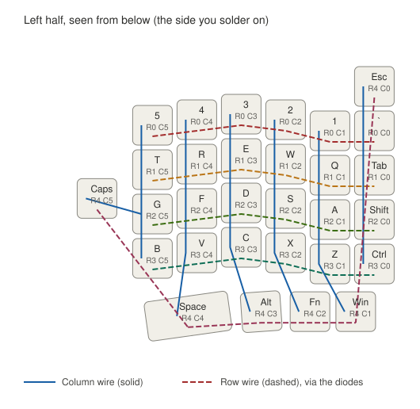
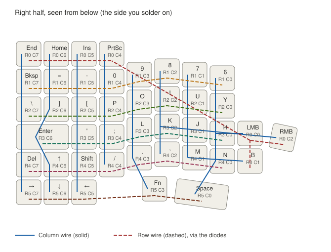

# Pinvyn v0.1 wiring plan

Generated by `layout/generate_wiring.py`. Edit the script, not this file.

Everything here is a plan that has not been built yet. Items tagged **VERIFY** must be checked against the actual boards and current ZMK documentation before soldering.

## How the matrix works

Each key sits at one row and one column. The controller finds a pressed key by which row and column are connected. One diode per key stops false presses when several keys are held.

- Diode direction: **the striped end of every diode goes to the row wire.** The other end goes to one switch pin.
- The other switch pin goes to the column wire.
- In ZMK this is `diode-direction = "col2row"`.
- Rows and columns are electrical groups. Most follow the physical rows and columns; a few keys are placed where a free slot was. Those need a short jumper wire, and the wires are insulated, so they may cross.

## Left half: 5 rows × 6 columns, 30 keys

| | C0 | C1 | C2 | C3 | C4 | C5 |
|---|---|---|---|---|---|---|
| **R0** | `` ` `` | 1 | 2 | 3 | 4 | 5 |
| **R1** | Tab | Q | W | E | R | T |
| **R2** | Shift | A | S | D | F | G |
| **R3** | Ctrl | Z | X | C | V | B |
| **R4** | Esc | Win | Fn | Alt | Space | Caps |

Jumpers: Esc joins row R4 with a wire down the outer edge. Caps joins row R4 and column C5.

| Line | Controller pin |
|---|---|
| Row R0 | P0.31 (D21) |
| Row R1 | P0.29 (D20) |
| Row R2 | P0.02 (D19) |
| Row R3 | P1.15 (D18) |
| Row R4 | P1.13 (D15) |
| Column C0 | P0.24 (D5) |
| Column C1 | P1.00 (D6) |
| Column C2 | P0.11 (D7) |
| Column C3 | P1.04 (D8) |
| Column C4 | P1.06 (D9) |
| Column C5 | P0.09 (D10) |
| Display MOSI | P0.17 (D2) |
| Display SCK | P0.20 (D3) |
| Display CS | P0.06 (D1) |
| Link TX, to right RX | P0.08 (D0) |
| Link RX, from right TX | P0.22 (D4) |
| Scroll V, A | P1.11 (D14) |
| Scroll V, B | P0.10 (D16) |
| Scroll H, A | P1.01 (pad underneath) |
| Scroll H, B | P1.02 (pad underneath) |
| Spare | P1.07 (pad underneath) |

## Right half: 6 rows × 8 columns, 43 keys

| | C0 | C1 | C2 | C3 | C4 | C5 | C6 | C7 |
|---|---|---|---|---|---|---|---|---|
| **R0** | LMB | B | RMB |  | PrtSc | Ins | Home | End |
| **R1** | 6 | 7 | 8 | 9 | 0 | - | = | Bksp |
| **R2** | Y | U | I | O | P | [ | ] | \\ |
| **R3** | H | J | K | L | ; | ' | Enter |  |
| **R4** | N | M | , | . | / | Shift | ↑ | Del |
| **R5** | Space |  |  | Fn |  | ← | ↓ | → |

Jumpers: the two mouse buttons and the second B join row R0, which otherwise holds the four top keys. Their column wires are the three nearest columns.

| Line | Controller pin |
|---|---|
| Row R0 | P0.31 (D21) |
| Row R1 | P0.29 (D20) |
| Row R2 | P0.02 (D19) |
| Row R3 | P1.15 (D18) |
| Row R4 | P1.13 (D15) |
| Row R5 | P1.11 (D14) |
| Column C0 | P0.17 (D2) |
| Column C1 | P0.20 (D3) |
| Column C2 | P0.22 (D4) |
| Column C3 | P0.24 (D5) |
| Column C4 | P1.00 (D6) |
| Column C5 | P0.11 (D7) |
| Column C6 | P1.04 (D8) |
| Column C7 | P1.06 (D9) |
| Link TX, to left RX | P0.06 (D1) |
| Link RX, from left TX | P0.08 (D0) |
| Sensor SCLK | P0.10 (D16) |
| Sensor SDIO | P0.09 (D10) |
| Sensor NCS | P1.01 (pad underneath) |
| Sensor MOTION | P1.02 (pad underneath) |
| Spare | P1.07 (pad underneath) |

## Pin names

Pins are given as the nRF52840 port name with the Pro Micro position in brackets. A nice!nano v2-type board has 18 pins on its edges and three pads underneath (P1.01, P1.02, P1.07). **VERIFY** the labels printed on the boards you bought; clones sometimes differ.

P0.09 and P0.10 double as NFC antenna pins on this chip. **VERIFY** that the firmware build uses them as normal pins.

## Cable between the halves (TRRS)

| Contact | Line | Left pin | Right pin |
|---|---|---|---|
| Tip | Power | see below | see below |
| Ring 1 | Left TX to right RX | P0.08 (D0) | P0.08 (D0) |
| Ring 2 | Right TX to left RX | P0.22 (D4) | P0.06 (D1) |
| Sleeve | Ground | GND | GND |

TX on one half always goes to RX on the other.

Power to the right half is **not decided. VERIFY** before wiring. The two candidates are the left board's 3.3 V pin to the right board's 3.3 V pin, or battery voltage to the right board's battery input.

Switch the keyboard off before plugging or unplugging this cable. The plug touches several contacts as it slides in.

## Other parts

- **Display (left):** three signal wires as in the table, plus 3.3 V and ground. These pins follow the usual nice!view wiring. **VERIFY** against the display's documentation.
- **Scrollers (left):** each encoder has two signal pins, A and B, and a common pin that goes to ground.
- **Trackball sensor (right):** four signal wires as in the table, plus power and ground. **VERIFY** the supply voltage of the sensor board you bought; some need 1.8 V and carry their own regulator.
- **Battery (left):** to the board's battery pads, through the slide switch on the positive wire.

## Order of work

1. Fit all switches into the plate.
2. Solder a diode to one pin of every switch, striped end pointing away from the switch.
3. Join the striped ends along each row. Add the jumpers.
4. Run a column wire along the free pin of each switch in a column. Add the jumpers.
5. Before connecting the controller, test with a multimeter: every row against every column should show no connection until a key is pressed.
6. Wire rows and columns to the controller, then the other parts.
7. Flash, and test every key before closing the case.
